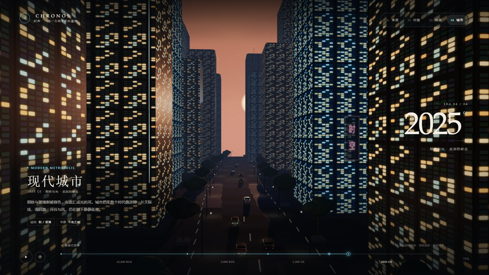

# CHRONOS · 时序之旅

一段自动向前的时间旅行：从 **史前草原** 出发，穿过 **原始村落** 与 **中世纪城堡**，最终驶入暮色中的 **现代城市**。

[在线体验](https://boriswzb.github.io/chronos-timeline/) · [直接打开单文件](https://boriswzb.github.io/chronos-timeline/chronos-timeline.html)



## 场景

- **史前草原**：猛犸群、狩猎营地、巨蕨、水塘与飞鸟
- **原始村落**：茅草屋、火塘、农田、篱笆、羊群与村民
- **中世纪城堡**：石墙、塔楼、拱门、旗帜、火把、乌鸦与城外小镇
- **现代城市**：玻璃高楼、发光窗格、霓虹招牌、车流与日落

镜头沿 Catmull-Rom 时间曲线连续前进。随着章节推进，天空、雾、光照、地形色彩和建筑群同步切换；城市会在时间雾中逐渐显现。

## 交互

| 操作 | 效果 |
| --- | --- |
| 自动播放 | 镜头沿时间轴平滑向前巡航 |
| 拖动画面 | 环顾四周，松手后缓慢回正 |
| 滚轮 | 调整视野（FOV） |
| 拖动时间轴 | 自由回溯或快进 |
| 点击顶部章节 / 年份 | 平滑跳转到对应时代 |
| `Space` | 暂停 / 继续 |
| `←` / `→` | 前后微调时间轴 |
| `R` | 重新开始 |

## 运行

这是一个完全自包含的单文件场景：

```text
chronos-timeline.html
```

直接双击打开即可。Three.js r160 已内嵌在 HTML 中，不依赖网络、CDN 或外部贴图。

## 技术说明

- Three.js / WebGL，程序化低多边形建模
- 自定义天空 shader（渐变、太阳光晕、程序化云）
- 风场草地、体积雾、烟雾粒子与布料顶点动画
- Canvas 程序化材质：石材、茅草、木材、窗格与霓虹招牌
- InstancedMesh 批量渲染植被、岩石、栅栏与城市灯光
- 全程序化场景，无外部模型与贴图

## License

场景代码可自由学习与修改。Three.js 以 MIT License 内嵌，版权归 Three.js Authors 所有。
